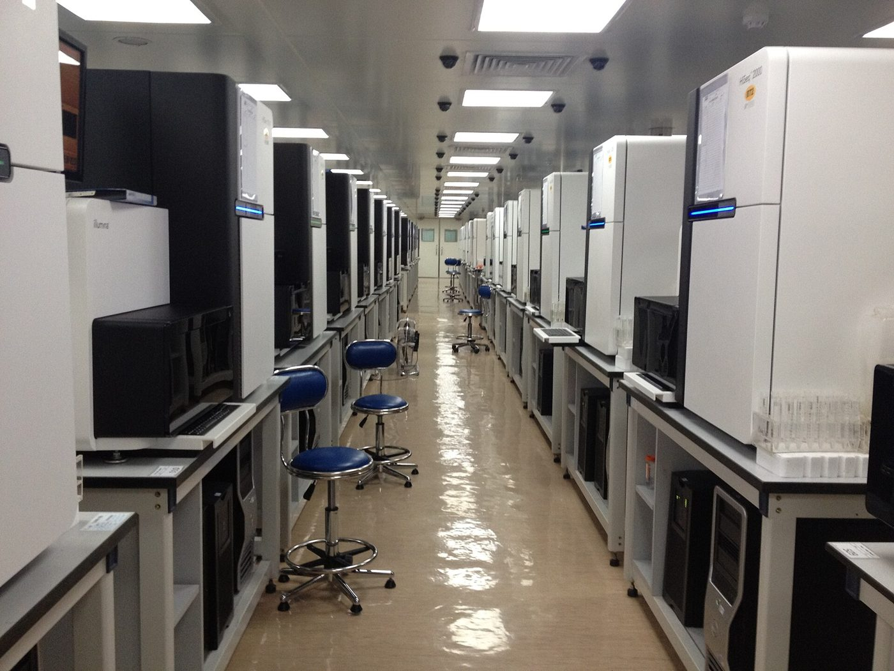
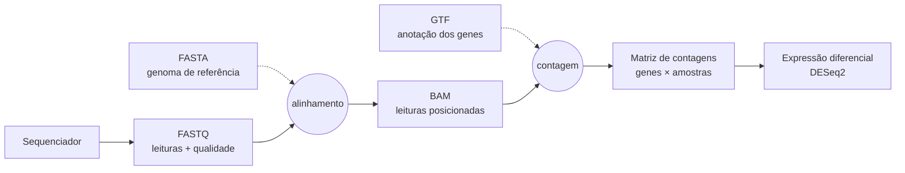
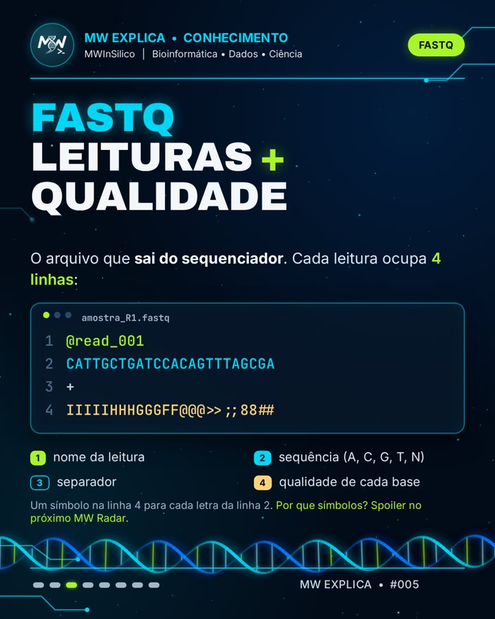
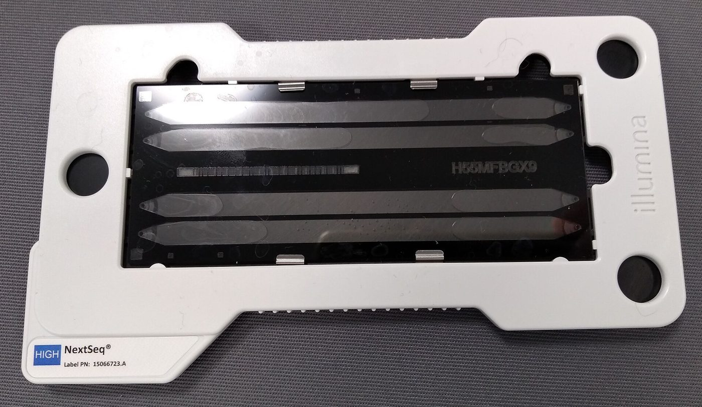
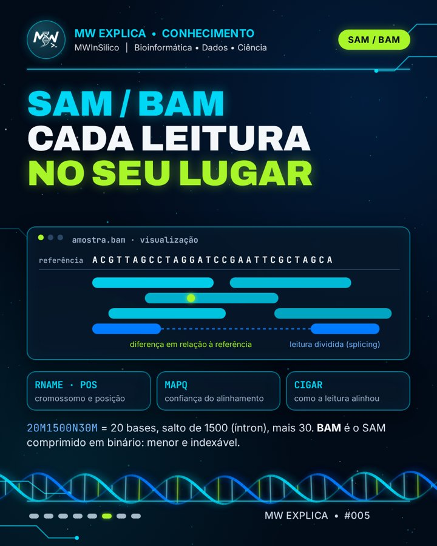

# 🗂️ Os arquivos do RNA-Seq: FASTQ, FASTA, GTF, BAM e a matriz de contagens

> **Toda análise de RNA-Seq é uma sequência de conversões de arquivo. Saber o que cada um guarda é o que permite entender, e depurar, qualquer pipeline.**

!!! tip "Para quem tem pressa"
    O sequenciador entrega **FASTQ**: milhões de leituras curtas, cada uma com a qualidade de cada base. Para dar sentido a elas, usamos duas referências públicas: o genoma em **FASTA** (a sequência) e a anotação em **GTF** (onde estão os genes). O alinhador posiciona cada leitura no genoma e grava o resultado em **SAM/BAM**. Por fim, contamos quantas leituras caíram em cada gene e chegamos à **matriz de contagens** (genes × amostras), que é a entrada da análise estatística com ferramentas como o DESeq2.

Este é o primeiro post do ciclo **"O que sai do sequenciador"**. Os próximos mostram como abrir esses arquivos no terminal Linux, como inspecionar um FASTQ real e por que a qualidade é escrita com símbolos.

## Sumário

1. [O caminho dos dados](#o-caminho-dos-dados)
2. [FASTQ: leituras e qualidade](#fastq-leituras-e-qualidade)
3. [FASTA: a sequência de referência](#fasta-a-sequencia-de-referencia)
4. [GTF: o mapa dos genes](#gtf-o-mapa-dos-genes)
5. [SAM e BAM: cada leitura no seu lugar](#sam-e-bam-cada-leitura-no-seu-lugar)
6. [A matriz de contagens](#a-matriz-de-contagens)
7. [Tabela-resumo](#tabela-resumo)
8. [Teste seus conhecimentos](#teste-seus-conhecimentos)
9. [Referências](#referencias)

---

## O caminho dos dados

<figure markdown>

<figcaption>Sequenciadores Illumina HiSeq 2000 no BGI, em Hong Kong. Cada equipamento desses produz arquivos FASTQ com centenas de milhões de leituras. Foto: Scotted400, <a href="https://commons.wikimedia.org/wiki/File:Illumina_Hiseq_2000_sequencers,_BGI_Hong_Kong_sequencing_room.JPG">Wikimedia Commons</a>, <a href="https://creativecommons.org/licenses/by/3.0">CC BY 3.0</a>.</figcaption>
</figure>

Num experimento de RNA-Seq, o RNA extraído vira uma biblioteca de cDNA, que é sequenciada (veja [RNA-Seq bulk](rna-seq-bulk.md)). A partir daí, tudo é dado: cada etapa do pipeline lê um formato de arquivo e escreve outro.



As linhas contínuas são os **seus dados**, que mudam de formato a cada etapa. As tracejadas são **referências públicas**, baixadas de bancos como o Ensembl ou o GENCODE, que precisam ser da **mesma versão** entre si.

!!! warning "O erro mais comum de iniciante"
    Usar um genoma FASTA de uma versão (por exemplo, GRCh38) com um GTF de outra (GRCh37/hg19). As coordenadas não batem, e o resultado sai errado sem nenhuma mensagem de erro. Baixe sempre o FASTA e o GTF do mesmo lançamento.

---

## FASTQ: leituras e qualidade

O FASTQ é o arquivo que **sai do sequenciador**. Ele guarda cada leitura (*read*) e, junto dela, a confiança do equipamento em cada base lida[^1]. Cada leitura ocupa exatamente **quatro linhas**:

```text
@A00123:8:H5KJ2DSXY:1:1101:10004:1000 1:N:0:ATCACG
CATTGCTGATCCACAGTTTAGCGA
+
IIIIIHHHGGGFF@@@>>;;88##
```

1. **Identificador**, começando com `@`. Nos equipamentos Illumina atuais, ele codifica o instrumento, a corrida, a flow cell, a posição do cluster e o número da leitura (1 ou 2).
2. **Sequência** das bases: A, C, G, T ou N (base não identificada).
3. **Separador** `+`, às vezes seguido de uma cópia do identificador.
4. **Qualidade**: um caractere para cada base da linha 2.

### Como ler a linha de qualidade

Cada caractere representa um **escore Phred** (Q), definido pela probabilidade *P* de a base estar errada[^2]:

*Q* = −10 × log₁₀(*P*)

Q10 significa 1 erro em 10, Q20 significa 1 em 100 e Q30, 1 em 1.000. Para caber em um único caractere, o valor é somado a 33 e gravado como o símbolo ASCII correspondente (codificação **Phred+33**). Assim, `I` (ASCII 73) vale Q40, e `#` (ASCII 35) vale Q2.

Clique em qualquer base abaixo para decodificar a qualidade:

<div class="mw-widget" id="fq-widget">
<style>
#fq-widget { border: 1px solid var(--md-default-fg-color--lightest); border-radius: 10px; padding: 20px; margin: 1.5rem 0; background: var(--md-default-bg-color); }
#fq-widget h4 { margin: 0 0 4px; font-size: 1.05rem; }
#fq-widget .fq-sub { color: var(--md-default-fg-color--light); font-size: .85rem; margin-bottom: 14px; }
#fq-widget .fq-row { display: flex; flex-wrap: wrap; gap: 3px; font-family: var(--md-code-font-family); }
#fq-widget .fq-cell { display: flex; flex-direction: column; align-items: center; width: 1.9em; padding: 4px 0; border-radius: 6px; cursor: pointer; border: 1.5px solid transparent; background: var(--md-code-bg-color); }
#fq-widget .fq-cell:hover, #fq-widget .fq-cell.sel { border-color: var(--md-primary-fg-color); }
#fq-widget .fq-b { font-weight: 700; color: var(--md-primary-fg-color); }
#fq-widget .fq-q { font-size: .8em; color: var(--md-default-fg-color--light); }
#fq-widget .fq-bar { width: 70%; margin-top: 4px; border-radius: 2px; }
#fq-widget .fq-out { margin-top: 16px; display: grid; grid-template-columns: repeat(auto-fit, minmax(130px, 1fr)); gap: 10px; }
#fq-widget .fq-box { border: 1px solid var(--md-default-fg-color--lightest); border-radius: 8px; padding: 10px 12px; }
#fq-widget .fq-box small { display: block; color: var(--md-default-fg-color--light); font-size: .72rem; text-transform: uppercase; letter-spacing: .05em; }
#fq-widget .fq-box b { font-size: 1.2rem; font-family: var(--md-code-font-family); }
#fq-widget .fq-note { margin-top: 12px; font-size: .82rem; color: var(--md-default-fg-color--light); }
</style>
<h4>🔎 Decodificador de qualidade (Phred+33)</h4>
<div class="fq-sub">Cada coluna é uma base da leitura. A barra mostra o escore de qualidade: quanto mais alta, mais confiável.</div>
<div class="fq-row" id="fq-row"></div>
<div class="fq-out" id="fq-out"></div>
<div class="fq-note" id="fq-note"></div>
<script>
(function(){
  var seq = "CATTGCTGATCCACAGTTTAGCGA", qual = "IIIIIHHHGGGFF@@@>>;;88##";
  var row = document.getElementById("fq-row"), out = document.getElementById("fq-out"), note = document.getElementById("fq-note");
  function color(q){ return q >= 30 ? "#2e9d5b" : (q >= 20 ? "#d9a514" : "#d0463b"); }
  function show(i){
    var c = qual[i], code = c.charCodeAt(0), q = code - 33, p = Math.pow(10, -q/10);
    var cells = row.children;
    for (var k = 0; k < cells.length; k++) cells[k].classList.toggle("sel", k === i);
    out.innerHTML =
      '<div class="fq-box"><small>Posição</small><b>' + (i+1) + '</b></div>' +
      '<div class="fq-box"><small>Base</small><b>' + seq[i] + '</b></div>' +
      '<div class="fq-box"><small>Símbolo</small><b>' + c.replace("<","&lt;") + '</b></div>' +
      '<div class="fq-box"><small>Código ASCII</small><b>' + code + '</b></div>' +
      '<div class="fq-box"><small>Phred (ASCII − 33)</small><b style="color:' + color(q) + '">Q' + q + '</b></div>' +
      '<div class="fq-box"><small>Chance de erro</small><b>' + (p < 0.01 ? '1 em ' + Math.round(1/p).toLocaleString("pt-BR") : Math.round(p*100) + '%') + '</b></div>';
    note.textContent = q >= 30 ? "Base confiável: Q30 ou mais é o padrão usado para dizer que uma corrida tem boa qualidade."
      : (q >= 20 ? "Qualidade intermediária. Ferramentas de trimming costumam cortar a ponta da leitura quando a qualidade cai abaixo de Q20."
      : "Qualidade muito baixa: essa base tem grande chance de estar errada. É comum no fim das leituras, e é por isso que o trimming existe.");
  }
  for (var i = 0; i < seq.length; i++) {
    var q = qual.charCodeAt(i) - 33, d = document.createElement("div");
    d.className = "fq-cell"; d.tabIndex = 0;
    d.innerHTML = '<span class="fq-b">' + seq[i] + '</span><span class="fq-q">' + qual[i].replace("<","&lt;") + '</span><span class="fq-bar" style="height:' + (q*1.1+2) + 'px;background:' + color(q) + '"></span>';
    (function(k){ d.addEventListener("click", function(){ show(k); }); d.addEventListener("keydown", function(e){ if (e.key === "Enter") show(k); }); })(i);
    row.appendChild(d);
  }
  show(0);
})();
</script>
</div>

!!! info "Por que +33?"
    Os primeiros 32 códigos da tabela ASCII são caracteres invisíveis (quebra de linha, tabulação etc.), e o 32 é o espaço. Começar no 33 (`!`) garante que todo escore vire um símbolo imprimível. Equipamentos Illumina antigos (versões 1.3 a 1.7 do pipeline) usavam **Phred+64**: se um FASTQ antigo parecer ter qualidades absurdas, essa é a primeira suspeita[^1].

<figure markdown>
{ width="380" }
<figcaption>As quatro linhas do FASTQ no carrossel do Instagram.</figcaption>
</figure>

### R1, R2 e .gz

- **Paired-end**: quando os dois lados de cada fragmento são sequenciados, cada amostra tem **dois arquivos**, `_R1.fastq.gz` e `_R2.fastq.gz`. A leitura de número *n* do R1 é o par da leitura *n* do R2, por isso os dois arquivos nunca devem ser ordenados ou filtrados separadamente.
- **Compressão**: FASTQ quase sempre vem comprimido com gzip (`.fastq.gz` ou `.fq.gz`). As ferramentas de bioinformática leem o arquivo comprimido diretamente, então não é preciso descompactar.

---

## FASTA: a sequência de referência

O formato FASTA nasceu com o programa de mesmo nome, de busca por similaridade de sequências[^3]. Ele é o formato mais simples possível: uma linha de cabeçalho começando com `>` e, abaixo, a sequência.

```text
>chrM
GATCACAGGTCTATCACCCTATTAACCACTCACGGGAGCTCTCCATGCATTTGGTATT
```

Este é o início real do DNA mitocondrial humano, na sequência de referência revisada de Cambridge (rCRS)[^4], que também faz parte do genoma de referência GRCh38.

<figure markdown>

<figcaption>Flow cell de um Illumina NextSeq: é na superfície de vidro dela que os fragmentos de DNA são lidos. O que sai daí é FASTQ; o FASTA é a referência contra a qual comparamos. Foto: Cirosantilli2, <a href="https://commons.wikimedia.org/wiki/File:Illumina_NextSeq_flow_cell.jpg">Wikimedia Commons</a>, <a href="https://creativecommons.org/licenses/by-sa/4.0">CC BY-SA 4.0</a>.</figcaption>
</figure>

| | FASTQ | FASTA |
|---|---|---|
| Começa com | `@` | `>` |
| Linhas por registro | sempre 4 | 1 de cabeçalho + quantas forem precisas |
| Tem qualidade? | sim, uma por base | não |
| De onde vem | do **seu** sequenciamento | de bancos públicos (Ensembl, GENCODE, NCBI) |
| Tamanho típico de cada sequência | 50 a 300 bases (Illumina) | de um gene a um cromossomo inteiro |

Um mesmo arquivo pode conter várias sequências (*multi-FASTA*): o genoma humano inteiro é um único FASTA com um registro por cromossomo. Para acessar um trecho rapidamente sem ler o arquivo todo, as ferramentas criam um índice `.fai` (com `samtools faidx`)[^9].

!!! tip "Genoma ou transcriptoma?"
    Alinhadores como o STAR usam o **genoma** em FASTA. Ferramentas de pseudo-alinhamento, como o Salmon, usam o **transcriptoma**: um FASTA com a sequência de cada transcrito já processado (sem íntrons). Os dois são baixados dos mesmos bancos.

Já mostramos como baixar um FASTA do NCBI no carrossel **MW na Prática #001**.

---

## GTF: o mapa dos genes

O FASTA diz **qual é** a sequência do genoma, mas não diz onde estão os genes. Essa informação vem da **anotação**, distribuída em GTF (*Gene Transfer Format*) ou no formato irmão GFF3[^5][^6]. Cada linha descreve um elemento (gene, transcrito, éxon, CDS…) em **9 colunas** separadas por tabulação:

| # | Coluna | Exemplo (TP53) | Significado |
|---|---|---|---|
| 1 | seqname | `chr17` | cromossomo |
| 2 | source | `HAVANA` | quem anotou |
| 3 | feature | `gene` | tipo do elemento |
| 4 | start | `7661779` | início |
| 5 | end | `7687538` | fim |
| 6 | score | `.` | não usado na anotação de genes |
| 7 | strand | `-` | fita (+ ou −) |
| 8 | frame | `.` | fase de leitura (só para CDS) |
| 9 | attributes | `gene_id "ENSG00000141510"; gene_name "TP53";` | identificadores e nomes |

O TP53, o mesmo gene do nosso carrossel sobre o NCBI, fica na **fita −** do cromossomo 17. Isso significa que ele é lido "de trás para frente" em relação à numeração do cromossomo.

!!! warning "Coordenadas: GTF começa em 1, BED começa em 0"
    No GTF, a primeira base do cromossomo é a posição **1**, e o intervalo inclui o início e o fim. No formato BED, outro muito usado, a contagem começa em **0** e o fim não é incluído. Converter entre os dois sem ajustar gera erros de uma base, difíceis de perceber.

=== "GTF"

    ```text
    chr17  HAVANA  gene  7661779  7687538  .  -  .  gene_id "ENSG00000141510"; gene_name "TP53";
    ```

=== "GFF3"

    ```text
    chr17  HAVANA  gene  7661779  7687538  .  -  .  ID=ENSG00000141510;gene_name=TP53
    ```

A diferença está só na última coluna: o GTF usa `chave "valor";` e o GFF3 usa `chave=valor`, com relações de parentesco explícitas (`Parent=`) entre gene, transcrito e éxon.

---

## SAM e BAM: cada leitura no seu lugar

O alinhador (STAR, HISAT2, BWA…) pega cada leitura do FASTQ, procura de onde ela veio no genoma FASTA e escreve o resultado em **SAM** (*Sequence Alignment/Map*)[^7]. O SAM é texto puro, com um cabeçalho (linhas começando com `@`) e uma linha por alinhamento, com **11 colunas obrigatórias**:

| # | Campo | O que guarda |
|---|---|---|
| 1 | QNAME | nome da leitura (o mesmo do FASTQ) |
| 2 | FLAG | um número que resume o estado da leitura (veja o decodificador abaixo) |
| 3 | RNAME | cromossomo onde ela alinhou |
| 4 | POS | posição da primeira base alinhada (começa em 1) |
| 5 | MAPQ | confiança de que a posição está certa, em escala Phred |
| 6 | CIGAR | como a leitura alinhou: bases iguais, inserções, deleções, íntrons |
| 7–9 | RNEXT, PNEXT, TLEN | onde está o par (em paired-end) e o tamanho do fragmento |
| 10 | SEQ | a sequência da leitura |
| 11 | QUAL | a qualidade, igual à do FASTQ |

O **BAM** é o mesmo conteúdo, comprimido em formato binário. Ele é bem menor que o SAM e, depois de ordenado por posição e indexado (arquivo `.bai`), permite ir direto a qualquer região do genoma. É assim que visualizadores como o IGV mostram as leituras de um gene instantaneamente[^8]. Na prática, quase ninguém guarda SAM: o `samtools` converte, ordena e indexa[^9].

<figure markdown>
{ width="380" }
<figcaption>Leituras alinhadas, uma diferença em relação à referência e uma leitura dividida por splicing.</figcaption>
</figure>

### A FLAG: muita informação num número só

A FLAG soma potências de 2. Cada uma é uma pergunta de sim ou não sobre a leitura. Marque as caixas, ou digite um valor, para ver a soma:

<div class="mw-widget" id="flag-widget">
<style>
#flag-widget { border: 1px solid var(--md-default-fg-color--lightest); border-radius: 10px; padding: 20px; margin: 1.5rem 0; background: var(--md-default-bg-color); }
#flag-widget h4 { margin: 0 0 12px; font-size: 1.05rem; }
#flag-widget .fl-top { display: flex; align-items: center; gap: 12px; flex-wrap: wrap; margin-bottom: 14px; }
#flag-widget input[type=number] { width: 7em; font: 700 1.2rem var(--md-code-font-family); padding: 6px 10px; border-radius: 8px; border: 1.5px solid var(--md-primary-fg-color); background: var(--md-code-bg-color); color: var(--md-default-fg-color); }
#flag-widget .fl-pre button { margin: 2px; padding: 4px 10px; border-radius: 14px; border: 1px solid var(--md-default-fg-color--lightest); background: transparent; color: var(--md-default-fg-color); cursor: pointer; font: .8rem var(--md-code-font-family); }
#flag-widget .fl-pre button:hover { border-color: var(--md-primary-fg-color); }
#flag-widget .fl-grid { display: grid; grid-template-columns: repeat(auto-fit, minmax(230px, 1fr)); gap: 6px 16px; }
#flag-widget label { display: flex; gap: 8px; align-items: baseline; font-size: .85rem; cursor: pointer; }
#flag-widget label code { min-width: 3.4em; text-align: right; }
#flag-widget label.on { color: var(--md-primary-fg-color); font-weight: 600; }
</style>
<h4>🧮 Decodificador de FLAG do SAM</h4>
<div class="fl-top">
  <input type="number" id="fl-val" min="0" max="4095" value="99" aria-label="Valor da FLAG">
  <span class="fl-pre">Exemplos:
    <button type="button" data-v="99">99</button><button type="button" data-v="147">147</button><button type="button" data-v="4">4</button><button type="button" data-v="16">16</button><button type="button" data-v="1024">1024</button>
  </span>
</div>
<div class="fl-grid" id="fl-grid"></div>
<script>
(function(){
  var bits = [[1,"leitura pareada (paired-end)"],[2,"par alinhado corretamente"],[4,"leitura NÃO alinhou"],[8,"o par NÃO alinhou"],[16,"alinhou na fita reversa"],[32,"o par alinhou na fita reversa"],[64,"é a leitura 1 do par (R1)"],[128,"é a leitura 2 do par (R2)"],[256,"alinhamento secundário"],[512,"falhou no controle de qualidade"],[1024,"duplicata de PCR ou óptica"],[2048,"alinhamento suplementar (quimérico)"]];
  var grid = document.getElementById("fl-grid"), val = document.getElementById("fl-val");
  bits.forEach(function(b){
    var l = document.createElement("label");
    l.innerHTML = '<input type="checkbox" data-b="' + b[0] + '"><code>' + b[0] + '</code><span>' + b[1] + '</span>';
    grid.appendChild(l);
  });
  function fromValue(v){
    grid.querySelectorAll("input").forEach(function(c){ var on = (v & +c.dataset.b) !== 0; c.checked = on; c.parentNode.classList.toggle("on", on); });
  }
  grid.addEventListener("change", function(){
    var v = 0; grid.querySelectorAll("input").forEach(function(c){ if (c.checked) v += +c.dataset.b; c.parentNode.classList.toggle("on", c.checked); });
    val.value = v;
  });
  val.addEventListener("input", function(){ fromValue(Math.max(0, Math.min(4095, parseInt(val.value || "0", 10)))); });
  document.querySelectorAll("#flag-widget .fl-pre button").forEach(function(b){ b.addEventListener("click", function(){ val.value = b.dataset.v; fromValue(+b.dataset.v); }); });
  fromValue(99);
})();
</script>
</div>

Os valores **99** e **147** são os mais comuns num BAM de paired-end: R1 e R2 de um mesmo par, ambos bem alinhados, um em cada fita.

### O CIGAR: como a leitura se encaixou

O CIGAR descreve o alinhamento como uma sequência de **número + letra**. `50M` significa 50 bases alinhadas. No RNA-Seq, a letra mais importante é o **N**: um salto no genoma sem bases da leitura, ou seja, um **íntron** que o splicing removeu. É assim que uma leitura de mRNA maduro aparece "partida" em dois éxons distantes.

<div class="mw-widget" id="cig-widget">
<style>
#cig-widget { border: 1px solid var(--md-default-fg-color--lightest); border-radius: 10px; padding: 20px; margin: 1.5rem 0; background: var(--md-default-bg-color); }
#cig-widget h4 { margin: 0 0 12px; font-size: 1.05rem; }
#cig-widget .cg-top { display: flex; gap: 10px; flex-wrap: wrap; align-items: center; margin-bottom: 14px; }
#cig-widget input[type=text] { font: 700 1.1rem var(--md-code-font-family); padding: 6px 10px; border-radius: 8px; border: 1.5px solid var(--md-primary-fg-color); background: var(--md-code-bg-color); color: var(--md-default-fg-color); width: 12em; }
#cig-widget .cg-pre button { margin: 2px; padding: 4px 10px; border-radius: 14px; border: 1px solid var(--md-default-fg-color--lightest); background: transparent; color: var(--md-default-fg-color); cursor: pointer; font: .8rem var(--md-code-font-family); }
#cig-widget svg { width: 100%; height: auto; display: block; }
#cig-widget ul { margin: 10px 0 0; font-size: .85rem; }
#cig-widget .cg-err { color: #d0463b; font-size: .85rem; }
</style>
<h4>✂️ Visualizador de CIGAR</h4>
<div class="cg-top">
  <input type="text" id="cg-in" value="20M1500N30M" aria-label="String CIGAR" spellcheck="false">
  <span class="cg-pre">Exemplos:
    <button type="button">50M</button><button type="button">20M1500N30M</button><button type="button">5S45M</button><button type="button">22M2I26M</button><button type="button">25M3D25M</button>
  </span>
</div>
<svg id="cg-svg" viewBox="0 0 760 150" xmlns="http://www.w3.org/2000/svg"></svg>
<ul id="cg-list"></ul>
<script>
(function(){
  var NS = "http://www.w3.org/2000/svg";
  var info = { M: ["alinhada", "#0097a7"], I: ["inserção na leitura", "#7cb342"], D: ["deleção na leitura", "#e53935"], N: ["íntron (salto no genoma)", "#5c6bc0"], S: ["soft-clip: não alinhou, mas fica no BAM", "#9e9e9e"], H: ["hard-clip: removida do BAM", "#bdbdbd"], "=": ["igual à referência", "#00897b"], X: ["diferente da referência", "#f57c00"], P: ["padding", "#bdbdbd"] };
  var input = document.getElementById("cg-in"), svg = document.getElementById("cg-svg"), list = document.getElementById("cg-list");
  function el(t, a){ var e = document.createElementNS(NS, t); for (var k in a) e.setAttribute(k, a[k]); return e; }
  function draw(){
    var s = input.value.trim().toUpperCase(), ops = [], re = /(\d+)([MIDNSHP=X])/g, m, used = 0;
    while ((m = re.exec(s))) { ops.push([+m[1], m[2]]); used += m[0].length; }
    svg.innerHTML = ""; list.innerHTML = "";
    if (!ops.length || used !== s.length) { list.innerHTML = '<li class="cg-err">CIGAR inválido. Use número + letra, como 20M1500N30M.</li>'; return; }
    // largura visual: íntrons longos são comprimidos para caber
    function vis(n, op){ return op === "N" ? Math.min(120, 30 + Math.log10(n + 1) * 25) : n * 6; }
    var total = ops.reduce(function(a, o){ return a + (o[1] === "H" || o[1] === "P" ? 0 : vis(o[0], o[1])); }, 0);
    var scale = Math.min(1, 700 / total), x = 30;
    svg.appendChild(el("text", { x: 30, y: 26, "font-size": 14, fill: "currentColor", opacity: .7 })).textContent = "genoma";
    svg.appendChild(el("line", { x1: 30, y1: 40, x2: 730, y2: 40, stroke: "currentColor", "stroke-opacity": .3, "stroke-width": 4 }));
    svg.appendChild(el("text", { x: 30, y: 136, "font-size": 14, fill: "currentColor", opacity: .7 })).textContent = "leitura";
    ops.forEach(function(o){
      var n = o[0], op = o[1], c = info[op][1];
      if (op === "H" || op === "P") return;
      var w = vis(n, op) * scale;
      if (op === "N") {
        svg.appendChild(el("path", { d: "M" + x + " 80 Q " + (x + w/2) + " 50 " + (x + w) + " 80", fill: "none", stroke: c, "stroke-width": 3, "stroke-dasharray": "6 5" }));
      } else if (op === "D") {
        svg.appendChild(el("line", { x1: x, y1: 80, x2: x + w, y2: 80, stroke: c, "stroke-width": 3 }));
      } else if (op === "I") {
        svg.appendChild(el("rect", { x: x, y: 92, width: Math.max(w, 6), height: 18, rx: 4, fill: c }));
      } else {
        svg.appendChild(el("rect", { x: x, y: 70, width: w, height: 22, rx: 6, fill: c, opacity: op === "S" ? .55 : 1 }));
      }
      var t = el("text", { x: x + Math.max(w, 6)/2, y: op === "N" ? 46 : 66, "text-anchor": "middle", "font-size": 13, "font-weight": 700, fill: c });
      t.textContent = n + op; svg.appendChild(t);
      if (op !== "I") x += w; else x += Math.max(w, 6);
    });
    ops.forEach(function(o){ var li = document.createElement("li"); li.innerHTML = "<code>" + o[0] + o[1] + "</code>: " + o[0] + " base" + (o[0] > 1 ? "s" : "") + " — " + info[o[1]][0]; list.appendChild(li); });
  }
  input.addEventListener("input", draw);
  document.querySelectorAll("#cig-widget .cg-pre button").forEach(function(b){ b.addEventListener("click", function(){ input.value = b.textContent; draw(); }); });
  draw();
})();
</script>
</div>

!!! note "E o CRAM?"
    Projetos grandes usam cada vez mais o **CRAM**, que comprime ainda mais guardando só as **diferenças** em relação ao genoma de referência[^10]. A contrapartida: para abrir um CRAM, é preciso ter exatamente o mesmo FASTA usado para criá-lo.

---

## A matriz de contagens

O último passo antes da estatística é **contar**. Para cada amostra, uma ferramenta percorre o BAM e, usando as coordenadas do GTF, decide a qual gene pertence cada leitura. O resultado é uma tabela com **uma linha por gene e uma coluna por amostra**:

| gene | ctrl_1 | ctrl_2 | trat_1 | trat_2 |
|---|---:|---:|---:|---:|
| TP53 | 812 | 790 | 1.640 | 1.702 |
| GAPDH | 15.230 | 14.987 | 15.102 | 15.511 |
| MYC | 402 | 388 | 96 | 110 |
| BRCA1 | 230 | 251 | 244 | 236 |

<small>Valores ilustrativos.</small>

Há três caminhos comuns para chegar a ela:

=== "featureCounts / HTSeq"

    Contam as leituras de um BAM que caem nos éxons de cada gene do GTF[^11][^12]. São os métodos clássicos depois de um alinhador como o STAR ou o HISAT2.

=== "STAR --quantMode GeneCounts"

    O próprio STAR conta as leituras por gene enquanto alinha e grava um arquivo `ReadsPerGene.out.tab` por amostra[^13]. Basta juntar as colunas de todas as amostras.

=== "Salmon + tximport"

    O Salmon pula o BAM e estima a abundância de cada **transcrito** direto do FASTQ. O pacote tximport soma os transcritos por gene e entrega uma matriz pronta para o DESeq2[^14].

!!! warning "Contagens brutas, não normalizadas"
    O DESeq2 espera **contagens brutas**: números inteiros, exatamente como saíram da contagem. Ele faz a própria normalização internamente[^15]. Dar a ele valores já normalizados (TPM, FPKM, CPM) quebra o modelo estatístico. Os próximos ciclos do MW Explica vão explicar o porquê.

---

## Tabela-resumo

| Arquivo | Extensões | Guarda | Etapa | Como espiar |
|---|---|---|---|---|
| FASTQ | `.fastq.gz`, `.fq.gz` | leituras + qualidade | sai do sequenciador | `zcat arquivo.fastq.gz \| head -8` |
| FASTA | `.fa`, `.fasta`, `.fna` | sequência de referência | referência do alinhamento | `head arquivo.fa` |
| GTF/GFF3 | `.gtf`, `.gff3` | posição dos genes | referência da contagem | `grep -v "^#" anotacao.gtf \| head` |
| SAM/BAM | `.sam`, `.bam` (+ `.bai`) | leituras alinhadas | sai do alinhador | `samtools view arquivo.bam \| head` |
| Matriz | `.tsv`, `.csv`, `.txt` | contagens gene × amostra | entrada do DESeq2 | `head contagens.tsv` |

Os comandos dessa última coluna são o assunto do próximo post, no **MW Toolbox**: [Terminal Linux para biólogos](terminal-linux.md).

---

## Teste seus conhecimentos

??? question "1. Quantas linhas ocupa cada leitura em um FASTQ, e o que cada uma guarda?"
    Quatro: o identificador (começa com `@`), a sequência, o separador `+` e a qualidade, com um símbolo por base.

??? question "2. Uma base tem o símbolo `5` na linha de qualidade. Qual é o escore Phred dela?"
    O caractere `5` tem código ASCII 53. Em Phred+33, Q = 53 − 33 = **20**, ou seja, 1 chance em 100 de estar errada.

??? question "3. Por que não dá para usar o FASTA do GRCh38 com o GTF do GRCh37?"
    Porque as coordenadas dos genes mudam entre as versões do genoma. As leituras seriam contadas nos genes errados, sem nenhuma mensagem de erro.

??? question "4. O que significa a letra N no CIGAR, e por que ela é tão comum em RNA-Seq?"
    N é um salto no genoma que não consome bases da leitura: um íntron. Como o RNA maduro já não tem íntrons, uma leitura que atravessa a junção entre dois éxons aparece dividida no genoma.

??? question "5. Por que o DESeq2 precisa de contagens brutas, e não de TPM?"
    Porque o modelo estatístico dele (binomial negativa) assume números inteiros de leituras e calcula a própria normalização. Valores já normalizados perdem a informação sobre a profundidade de cada amostra, da qual a estimativa de variância depende.

---

## Referências

[^1]: Cock PJA, Fields CJ, Goto N, Heuer ML, Rice PM. The Sanger FASTQ file format for sequences with quality scores, and the Solexa/Illumina FASTQ variants. *Nucleic Acids Research*. 2010;38(6):1767–1771. doi: [10.1093/nar/gkp1137](https://doi.org/10.1093/nar/gkp1137).

[^2]: Ewing B, Green P. Base-calling of automated sequencer traces using Phred. II. Error probabilities. *Genome Research*. 1998;8(3):186–194. doi: [10.1101/gr.8.3.186](https://doi.org/10.1101/gr.8.3.186).

[^3]: Pearson WR, Lipman DJ. Improved tools for biological sequence comparison. *Proceedings of the National Academy of Sciences USA*. 1988;85(8):2444–2448. doi: [10.1073/pnas.85.8.2444](https://doi.org/10.1073/pnas.85.8.2444).

[^4]: Andrews RM, Kubacka I, Chinnery PF, Lightowlers RN, Turnbull DM, Howell N. Reanalysis and revision of the Cambridge reference sequence for human mitochondrial DNA. *Nature Genetics*. 1999;23(2):147. doi: [10.1038/13779](https://doi.org/10.1038/13779).

[^5]: Mudge JM, Carbonell-Sala S, Diekhans M, et al. GENCODE 2025: reference gene annotation for human and mouse. *Nucleic Acids Research*. 2025;53(D1):D966–D975. doi: [10.1093/nar/gkae1078](https://doi.org/10.1093/nar/gkae1078).

[^6]: Ensembl. GFF/GTF file format. Documentação oficial: <https://www.ensembl.org/info/website/upload/gff.html>.

[^7]: Li H, Handsaker B, Wysoker A, et al. The Sequence Alignment/Map format and SAMtools. *Bioinformatics*. 2009;25(16):2078–2079. doi: [10.1093/bioinformatics/btp352](https://doi.org/10.1093/bioinformatics/btp352). Especificação atual: <https://samtools.github.io/hts-specs/SAMv1.pdf>.

[^8]: Robinson JT, Thorvaldsdóttir H, Winckler W, et al. Integrative genomics viewer. *Nature Biotechnology*. 2011;29(1):24–26. doi: [10.1038/nbt.1754](https://doi.org/10.1038/nbt.1754).

[^9]: Danecek P, Bonfield JK, Liddle J, et al. Twelve years of SAMtools and BCFtools. *GigaScience*. 2021;10(2):giab008. doi: [10.1093/gigascience/giab008](https://doi.org/10.1093/gigascience/giab008).

[^10]: Hsi-Yang Fritz M, Leinonen R, Cochrane G, Birney E. Efficient storage of high throughput DNA sequencing data using reference-based compression. *Genome Research*. 2011;21(5):734–740. doi: [10.1101/gr.114819.110](https://doi.org/10.1101/gr.114819.110).

[^11]: Liao Y, Smyth GK, Shi W. featureCounts: an efficient general purpose program for assigning sequence reads to genomic features. *Bioinformatics*. 2014;30(7):923–930. doi: [10.1093/bioinformatics/btt656](https://doi.org/10.1093/bioinformatics/btt656).

[^12]: Anders S, Pyl PT, Huber W. HTSeq — a Python framework to work with high-throughput sequencing data. *Bioinformatics*. 2015;31(2):166–169. doi: [10.1093/bioinformatics/btu638](https://doi.org/10.1093/bioinformatics/btu638).

[^13]: Dobin A, Davis CA, Schlesinger F, et al. STAR: ultrafast universal RNA-seq aligner. *Bioinformatics*. 2013;29(1):15–21. doi: [10.1093/bioinformatics/bts635](https://doi.org/10.1093/bioinformatics/bts635).

[^14]: Soneson C, Love MI, Robinson MD. Differential analyses for RNA-seq: transcript-level estimates improve gene-level inferences. *F1000Research*. 2015;4:1521. doi: [10.12688/f1000research.7563.1](https://doi.org/10.12688/f1000research.7563.1).

[^15]: Love MI, Huber W, Anders S. Moderated estimation of fold change and dispersion for RNA-seq data with DESeq2. *Genome Biology*. 2014;15:550. doi: [10.1186/s13059-014-0550-8](https://doi.org/10.1186/s13059-014-0550-8).
