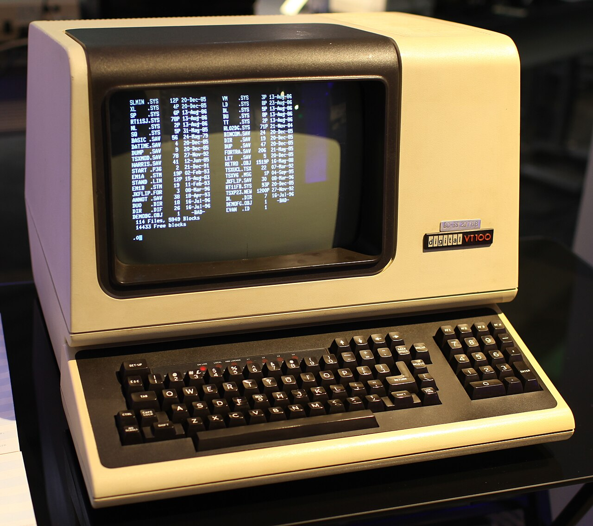
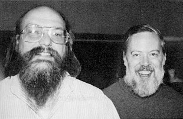
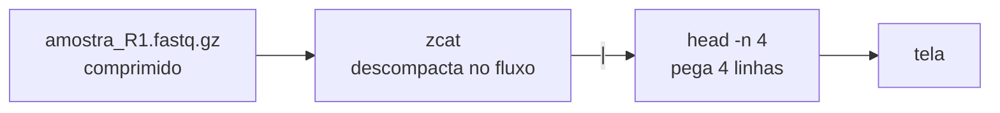

# 💻 Terminal Linux para biólogos: abrir, contar e buscar nos seus dados

> **Cinco comandos resolvem a maior parte do que você precisa fazer com um arquivo de sequenciamento antes de qualquer análise: ver o que tem, espiar o começo, abrir o comprimido, contar e buscar.**

!!! tip "Para quem tem pressa"
    Arquivos de sequenciamento são grandes demais para programas com janela, como o Excel ou o Bloco de notas, que tentam carregar tudo na memória. O terminal lê o arquivo **linha a linha**, em fluxo, e mostra só o que você pediu. Com `ls -lh` você vê os arquivos e seus tamanhos; com `head`, as primeiras linhas; com `zcat`, abre um `.gz` sem descompactar no disco; com `wc -l`, conta linhas (num FASTQ, linhas ÷ 4 = leituras); e com `grep`, busca um padrão. O símbolo `|` (*pipe*) liga um comando ao outro. No fim da página há um terminal de treino para você testar tudo.

Este é o primeiro **MW Toolbox**, a série sobre as ferramentas do dia a dia da bioinformática. Ele continua o post anterior, [Os arquivos do RNA-Seq](arquivos-rna-seq.md): lá vimos o que cada formato guarda; aqui vamos abrir esses arquivos de verdade.

---

## Por que não abrir no Excel?

Uma corrida típica de RNA-Seq gera dezenas de milhões de leituras por amostra. Como cada leitura ocupa quatro linhas no FASTQ, uma amostra com **20 milhões de leituras** vira um arquivo com **80 milhões de linhas**. O Excel aceita no máximo 1.048.576 linhas por planilha, ou seja, cerca de 76 vezes menos. Editores de texto comuns nem chegam a esse limite: tentam carregar o arquivo inteiro na memória e travam.

O terminal funciona de outro jeito. Os comandos do Unix foram pensados para ler um **fluxo de texto**, uma linha de cada vez, e passar o resultado adiante[^1]. Por isso `head` mostra o começo de um arquivo de 10 GB tão rápido quanto o de um arquivo de 10 linhas: ele lê só o que precisa e para.

<figure markdown>
{ width="520" }
<figcaption>O VT100, terminal da DEC lançado em 1978. O "terminal" do seu computador é a versão em software desse equipamento: uma tela que manda texto para o sistema e mostra o texto que volta. Foto: Jason Scott, <a href="https://commons.wikimedia.org/wiki/File:DEC_VT100_terminal.jpg">Wikimedia Commons</a>, <a href="https://creativecommons.org/licenses/by/2.0">CC BY 2.0</a>.</figcaption>
</figure>

Há ainda um motivo prático: os servidores e clusters onde as análises de verdade rodam **não têm tela**. Você se conecta a eles por um terminal. Aprender esses comandos no seu computador é o primeiro passo para trabalhar num cluster[^2].

??? info "Um pouco de história: de onde vêm esses comandos"
    O Unix foi criado no fim dos anos 1960 por Ken Thompson e Dennis Ritchie, nos Bell Labs, e descrito em artigo em 1974[^1]. A ideia do *pipe*, ligar a saída de um programa à entrada do outro, foi proposta por Doug McIlroy e entrou no sistema em 1973[^3]. Daí veio a filosofia que você vai usar aqui: programas pequenos, que fazem uma coisa bem feita e se combinam. O Linux, criado por Linus Torvalds em 1991, segue essa mesma tradição, e os comandos deste post funcionam praticamente iguais em Linux, macOS e no WSL do Windows.

    <figure markdown>
    { width="310" }
    <figcaption>Ken Thompson (à esquerda) e Dennis Ritchie, criadores do Unix, em 1973. Foto: autor desconhecido, <a href="https://commons.wikimedia.org/wiki/File:Ken_Thompson_and_Dennis_Ritchie--1973.jpg">Wikimedia Commons</a>, domínio público.</figcaption>
    </figure>

---

## Como abrir um terminal

=== "Linux"

    Procure por **Terminal** no menu de aplicativos (no Ubuntu, o atalho é ++ctrl+alt+t++). Os comandos deste post já vêm instalados.

=== "macOS"

    Abra **Aplicativos → Utilitários → Terminal**. Quase tudo funciona igual, com uma exceção: o `zcat` do macOS pode não ler `.gz`. Use `gzcat` no lugar dele, que funciona em qualquer versão.

=== "Windows"

    Instale o **WSL** (Subsistema do Windows para Linux), que roda um Ubuntu de verdade dentro do Windows[^4]. Abra o PowerShell como administrador e digite:

    ```powershell
    wsl --install
    ```

    Reinicie o computador, abra o aplicativo **Ubuntu** e crie seu usuário. Seus arquivos do Windows ficam acessíveis em `/mnt/c/`.

---

## Anatomia de um comando

Todo comando segue a mesma estrutura: o **nome** do programa, as **opções** (que começam com `-` e mudam o comportamento) e os **argumentos** (em geral, o arquivo onde ele vai trabalhar).

<div class="mw-anatomia" markdown>

```text
$  head   -n 3   contagens.tsv
   ────   ────   ─────────────
   nome   opção   argumento
```

</div>

O `$` é o *prompt*: o terminal avisando que está pronto. Você não digita o `$`. Opções de uma letra podem ser juntadas: `ls -l -h` e `ls -lh` são a mesma coisa. Para ver todas as opções de um comando, use `man comando` (sai com ++q++) ou `comando --help`.

!!! warning "O terminal diferencia maiúsculas de minúsculas"
    `Amostra.fastq.gz` e `amostra.fastq.gz` são arquivos diferentes. E evite espaços nos nomes de arquivo: `minha amostra.fastq` vira dois argumentos. Prefira `minha_amostra.fastq`: nomes sem espaços e sem acentos poupam dor de cabeça em qualquer programa[^6].

---

## Passo 1 · `ls`: o que tem nesta pasta?

```console
$ ls -lh
-rw-r--r-- 1 mw lab 1.2G Oct 30 10:12 amostra_R1.fastq.gz
-rw-r--r-- 1 mw lab 1.2G Oct 30 10:12 amostra_R2.fastq.gz
-rw-r--r-- 1 mw lab 1.9M Oct 30 11:40 contagens.tsv
-rw-r--r-- 1 mw lab  52M Oct 30 09:05 genes.gtf.gz
```

`ls` **lista** os arquivos. A opção `-l` pede o formato longo (permissões, dono, tamanho, data e nome) e `-h` mostra o tamanho em unidades legíveis (K, M, G) em vez de bytes. Os arquivos `_R1` e `_R2` são as duas leituras de cada fragmento num sequenciamento *paired-end*.

Para se mover entre pastas, dois comandos bastam no começo:

| Comando | O que faz |
|---|---|
| `pwd` | mostra a pasta onde você está (*print working directory*) |
| `cd rnaseq` | entra na pasta `rnaseq` |
| `cd ..` | volta uma pasta |
| `cd ~` | volta para a sua pasta pessoal |

!!! tip "Use a tecla Tab"
    Digite `cd rna` e aperte ++tab++: o terminal completa o nome. Além de poupar digitação, evita erro de grafia. A seta ++arrow-up++ traz de volta os comandos anteriores.

---

## Passo 2 · `head`: veja só o começo

```console
$ head -n 3 contagens.tsv
gene_id   ctrl_1   ctrl_2   trat_1   trat_2
TP53         812      790     1640     1702
GAPDH      15230    14987    15102    15511
```

`head` mostra as **primeiras** linhas de um arquivo: 10, se você não disser quantas, ou o número que vier depois de `-n`. É o jeito mais rápido de conferir se um arquivo é o que você acha que é: se tem cabeçalho, se as colunas estão separadas por tabulação, se os nomes dos genes são símbolos (TP53) ou identificadores do Ensembl (ENSG...).

Dois parentes úteis:

- `tail -n 3 arquivo` mostra as **últimas** linhas. Bom para ver se um arquivo terminou de ser gravado.
- `less arquivo` abre o arquivo para rolar com as setas, sem carregar tudo na memória. Digite `/TP53` para buscar e ++q++ para sair.

---

## Passo 3 · `zcat`: abra o `.gz` sem descompactar

Arquivos FASTQ quase sempre vêm comprimidos com gzip (extensão `.gz`), o que reduz o tamanho a cerca de um quarto. Se você usar `head` direto num `.gz`, vai ver só símbolos estranhos: são os bytes comprimidos. O `zcat` descompacta **no fluxo**, sem gravar nada no disco:

```console
$ zcat amostra_R1.fastq.gz | head -n 4
@A00123:8:H5KJ2DSXY:1:1101:10004:1000 1:N:0:ATCACG
CATTGCTGATCCACAGTTTAGCGA
+
IIIIIHHHGGGFF@@@>>;;88##
```

Essas quatro linhas são uma leitura completa (veja [como ler um FASTQ](arquivos-rna-seq.md#fastq-leituras-e-qualidade)). O símbolo `|` é o **pipe**: ele pega tudo o que o `zcat` escreveria na tela e entrega ao `head`, que mostra as 4 primeiras linhas e encerra a leitura.



!!! danger "Nunca rode `zcat arquivo.fastq.gz` sozinho"
    Sem o `| head`, o terminal vai despejar os 80 milhões de linhas na tela. Se isso acontecer, aperte ++ctrl+c++ para interromper. Vale para qualquer comando que demore mais do que você esperava.

---

## Passo 4 · `wc -l`: quantas leituras eu tenho?

```console
$ zcat amostra_R1.fastq.gz | wc -l
80000000
```

`wc` (*word count*) conta linhas, palavras e caracteres; com `-l`, só as linhas. Como cada leitura do FASTQ ocupa exatamente 4 linhas, basta dividir por 4: **80.000.000 ÷ 4 = 20 milhões de leituras**.

O próprio terminal faz a conta:

```console
$ echo $(( $(zcat amostra_R1.fastq.gz | wc -l) / 4 ))
20000000
```

E, com um laço `for`, faz para todas as amostras da pasta de uma vez:

```bash
for f in *_R1.fastq.gz; do
  echo "$f  $(( $(zcat "$f" | wc -l) / 4 ))"
done
```

O `*` é um curinga: `*_R1.fastq.gz` significa "todo arquivo que termina em `_R1.fastq.gz`". Contar as leituras é a primeira checagem de qualidade de qualquer projeto: se uma amostra tem muito menos leituras que as outras, você quer saber disso antes de gastar horas alinhando.

---

## Passo 5 · `grep`: procure um padrão

```console
$ zcat amostra_R1.fastq.gz | grep -c AGATCGGAAGAGC
1843270
```

`grep` mostra as linhas que **contêm** um padrão de texto. Com `-c`, em vez de mostrar as linhas, ele conta quantas são. Neste exemplo, o padrão `AGATCGGAAGAGC` é o início do **adaptador Illumina** (TruSeq), o pedaço de DNA sintético ligado aos fragmentos no preparo da biblioteca. Quando o fragmento é mais curto que a leitura, o sequenciador lê o fragmento inteiro e continua pelo adaptador. Essas sobras precisam ser removidas antes do alinhamento, no passo de *trimming*[^5].

| Opção | O que faz | Exemplo |
|---|---|---|
| `-c` | conta as linhas que batem | `grep -c TP53 contagens.tsv` |
| `-v` | inverte: linhas que **não** têm o padrão | `grep -v "^#" anotacao.gtf` (tira comentários) |
| `-i` | ignora maiúsculas e minúsculas | `grep -i tp53 contagens.tsv` |
| `-w` | só a palavra inteira | `grep -w TP53` não pega `TP53BP1` |

??? note "Por que essa contagem é só uma estimativa"
    O `grep -c` conta só as leituras que têm os **13 nucleotídeos completos** do adaptador. Uma leitura que termina com um pedaço dele (por exemplo, só `AGATCGG`) não entra na conta, e é justamente nesses pedaços que o adaptador mais aparece. Por isso, para remover adaptadores de verdade, usamos ferramentas como o Cutadapt[^5], que aceitam correspondências parciais e erros de sequenciamento. Ele está no próximo ciclo da série.

---

## Treine aqui: um terminal no navegador

Abaixo há um terminal de treino com uma pasta parecida com a dos exemplos, mas com arquivos pequenos: o FASTQ tem só **10 leituras**. Clique nos comandos sugeridos ou digite os seus. Ele entende `ls`, `pwd`, `head`, `tail`, `cat`, `zcat`, `wc`, `grep` e o pipe `|`.

<div class="mw-widget" id="term-widget">
<style>
#term-widget { border: 1px solid var(--md-default-fg-color--lightest); border-radius: 10px; margin: 1.5rem 0; overflow: hidden; background: #021517; }
#term-widget .tw-bar { display: flex; align-items: center; gap: 7px; padding: 9px 14px; background: #062226; border-bottom: 1px solid rgba(47,230,208,.25); }
#term-widget .tw-bar i { width: 11px; height: 11px; border-radius: 50%; background: #1E4C4A; }
#term-widget .tw-bar i:first-child { background: #2FE6D0; }
#term-widget .tw-bar span { margin-left: 8px; font-family: var(--md-code-font-family); font-size: .75rem; color: #8DB3B0; }
#term-widget .tw-out { height: 300px; overflow-y: auto; padding: 12px 16px 4px; font-family: var(--md-code-font-family); font-size: .78rem; line-height: 1.55; color: #CFE6E3; white-space: pre; font-variant-ligatures: none; }
#term-widget .tw-out .p { color: #14B8A6; font-weight: 700; }
#term-widget .tw-out .c { color: #F2FBFA; font-weight: 700; }
#term-widget .tw-out .e { color: #FF8A80; }
#term-widget .tw-out .n { color: #8DB3B0; font-style: italic; white-space: pre-wrap; }
#term-widget .tw-in { display: flex; align-items: center; gap: 8px; padding: 6px 16px 12px; font-family: var(--md-code-font-family); font-size: .78rem; }
#term-widget .tw-in b { color: #14B8A6; }
#term-widget .tw-in input { flex: 1; min-width: 0; background: transparent; border: 0; outline: 0; color: #F2FBFA; font: inherit; caret-color: #2FE6D0; }
#term-widget .tw-sug { display: flex; flex-wrap: wrap; gap: 6px; padding: 10px 14px 14px; border-top: 1px solid rgba(47,230,208,.18); background: #031B1D; }
#term-widget .tw-sug button { font-family: var(--md-code-font-family); font-size: .7rem; padding: 4px 9px; border-radius: 6px; border: 1px solid rgba(47,230,208,.45); background: #0A2E30; color: #2FE6D0; cursor: pointer; }
#term-widget .tw-sug button:hover { background: #2FE6D0; color: #021517; }
</style>
<div class="tw-bar"><i></i><i></i><i></i><span>mw@lab: ~/rnaseq · terminal de treino</span></div>
<div class="tw-out" id="tw-out" aria-live="polite"></div>
<div class="tw-in"><b>$</b><input id="tw-input" type="text" autocomplete="off" autocapitalize="off" spellcheck="false" aria-label="Digite um comando" placeholder="digite um comando e aperte Enter (help mostra a lista)"></div>
<div class="tw-sug" id="tw-sug"></div>
<script>
(function(){
  var out = document.getElementById("tw-out"), inp = document.getElementById("tw-input"), sug = document.getElementById("tw-sug");
  // ---- arquivos da pasta de treino ----
  var seqs = ["CATTGCTGATCCACAGTTTAGCGA", "GGCTAGATCGGAAGAGCACACGTC", "TTGACCGTAGGCATCGATTACGGA", "AACGTGGATCCTTAGCAGATCGGA", "CCTAGGAGATCGGAAGAGCACACG",
              "GATTACAGGCATGAGCCACCGCGC", "TTTCAGCATGCTAGCTAGGACTAC", "ACGTAGATCGGAAGAGCACACGTC", "GGGCTTAACCGTAGGCATTTACCA", "NCTGATCCACAGTTTAGCGATTGA"];
  var quals = ["IIIIIHHHGGGFF@@@>>;;88##", "IIIIIIIIIIIIIHHHHGGGFFF@", "IIIIIIIHHHHGGGGFFFFEEE@@", "IIIIHHHGGGFFF@@@>>>;;;88", "IIIIIIIIIIIIIIIIIHHHHGGG",
               "IIIIIIIHHHGGGFFF@@@>>;;;", "IIIIIIIIIIIIHHHHHGGGGFFF", "IIIIIIIIIIIHHHGGGFF@@@>>", "IIIIIIHHHHGGGGFFF@@@@>>>", "#IIIIIHHHGGGFF@@@>>;;888"];
  var fq = [];
  for (var i = 0; i < seqs.length; i++) fq.push("@A00123:8:H5KJ2DSXY:1:1101:" + (10004 + i * 1517) + ":" + (1000 + i * 37) + " 1:N:0:ATCACG", seqs[i], "+", quals[i]);
  var files = {
    "amostra_R1.fastq.gz": { gz: true, size: 498, date: "Oct 30 10:12", lines: fq },
    "contagens.tsv": { date: "Oct 30 11:40", lines: [
      "gene_id\tctrl_1\tctrl_2\ttrat_1\ttrat_2", "TP53\t812\t790\t1640\t1702", "GAPDH\t15230\t14987\t15102\t15511",
      "MYC\t402\t388\t96\t110", "BRCA1\t230\t251\t244\t236", "ACTB\t20110\t19876\t20540\t20302"] },
    "LEIAME.txt": { date: "Oct 30 09:01", lines: [
      "Pasta de treino do MW Toolbox #001.", "amostra_R1.fastq.gz: 10 leituras de 24 bases (comprimido).",
      "contagens.tsv: matriz de contagens ilustrativa, separada por tabulação.", "Dica: comece com  ls -lh  e depois  head LEIAME.txt"] }
  };
  function bytes(ls){ return ls.reduce(function(s, x){ return s + new TextEncoder().encode(x).length + 1; }, 0); }
  for (var k in files) if (!files[k].size) files[k].size = bytes(files[k].lines);
  function esc(s){ return String(s).replace(/&/g,"&amp;").replace(/</g,"&lt;").replace(/>/g,"&gt;"); }
  function print(html){ out.insertAdjacentHTML("beforeend", html + "\n"); out.scrollTop = out.scrollHeight; }
  function note(t){ print('<span class="n">' + esc(t) + '</span>'); }
  function human(b){ return b < 1024 ? String(b) : (b / 1024).toFixed(1) + "K"; }
  function tab(l){ return l.split("\t").map(function(c, k){ return k === 0 ? (c + "        ").slice(0, 9) : ("        " + c).slice(-8); }).join(" "); }
  function err(cmd, msg){ return { err: cmd + ": " + msg }; }
  function getFile(cmd, name){
    if (!Object.prototype.hasOwnProperty.call(files, name)) return err(cmd, "não foi possível abrir '" + name + "': Arquivo ou diretório inexistente");
    return { file: files[name] };
  }
  function nOpt(args){
    var n = 10, rest = [];
    for (var i = 0; i < args.length; i++) {
      var a = args[i];
      if (a === "-n") { n = parseInt(args[++i], 10); }
      else if (/^-n\d+$/.test(a)) n = parseInt(a.slice(2), 10);
      else if (/^-\d+$/.test(a)) n = parseInt(a.slice(1), 10);
      else rest.push(a);
    }
    return { n: isNaN(n) ? 10 : n, rest: rest };
  }
  // conteúdo de um arquivo para comandos que não descompactam
  function raw(f){ return f.gz ? ["‹¨áˆgamostra_R1.fastq­”ÛnÛ0Ž¼ÿ°ý…¢Çؿʦþ", "ò¶Ã9µ®ÿÕ‡ÚlÁ¤Ÿª"] : f.lines; }
  var cmds = {
    help: function(){ return { lines: ["Comandos do terminal de treino:", "  ls [-l] [-h]       lista os arquivos", "  pwd                mostra a pasta atual",
      "  head [-n N] arq    primeiras linhas", "  tail [-n N] arq    últimas linhas", "  cat arq            mostra o arquivo inteiro", "  zcat arq.gz        descompacta no fluxo",
      "  wc [-l] [arq]      conta linhas", "  grep [-c -v -i -w] PADRÃO [arq]", "  clear              limpa a tela", "Use | para ligar um comando ao outro."] }; },
    pwd: function(){ return { lines: ["/home/mw/rnaseq"] }; },
    clear: function(){ out.innerHTML = ""; return { lines: [] }; },
    cd: function(){ return { note: "Nesta pasta de treino não há subpastas. No seu terminal, cd entra numa pasta e cd .. volta uma." }; },
    less: function(){ return { note: "O less abre um visualizador interativo, que este treino não simula. No seu terminal, use as setas para rolar e q para sair." }; },
    ls: function(args, input, piped){
      var flags = args.filter(function(a){ return a[0] === "-"; }).join("");
      var names = Object.keys(files).sort(function(a, b){ return a.toLowerCase() < b.toLowerCase() ? -1 : 1; });
      if (flags.indexOf("l") < 0) return { lines: piped ? names : [names.join("  ")] };
      return { lines: names.map(function(k){ var f = files[k], s = flags.indexOf("h") >= 0 ? human(f.size) : String(f.size);
        return "-rw-r--r-- 1 mw lab " + ("     " + s).slice(-5) + " " + f.date + " " + k; }) };
    },
    cat: function(args, input){
      if (!args.length) return { lines: input || [] };
      var g = getFile("cat", args[0]); if (g.err) return g;
      return { lines: raw(g.file), warn: g.file.gz ? "Esses símbolos são os bytes comprimidos. Use zcat para ler um .gz." : null };
    },
    zcat: function(args, input){
      if (!args.length) return err("zcat", "informe um arquivo .gz");
      var g = getFile("zcat", args[0]); if (g.err) return g;
      if (!g.file.gz) return err("zcat", args[0] + ": not in gzip format");
      return { lines: g.file.lines };
    },
    head: function(args, input){
      var o = nOpt(args), src;
      if (o.rest.length) { var g = getFile("head", o.rest[0]); if (g.err) return g; src = raw(g.file); if (g.file.gz) return { lines: src, warn: "Esses símbolos são os bytes comprimidos. Tente: zcat " + o.rest[0] + " | head" }; }
      else src = input || [];
      return { lines: src.slice(0, o.n) };
    },
    tail: function(args, input){
      var o = nOpt(args), src;
      if (o.rest.length) { var g = getFile("tail", o.rest[0]); if (g.err) return g; src = raw(g.file); if (g.file.gz) return { lines: src, warn: "Esses símbolos são os bytes comprimidos. Tente: zcat " + o.rest[0] + " | tail" }; }
      else src = input || [];
      return { lines: o.n > 0 ? src.slice(-o.n) : [] };
    },
    wc: function(args, input){
      var flags = args.filter(function(a){ return a[0] === "-"; }).join(""), names = args.filter(function(a){ return a[0] !== "-"; }), src, label = "";
      if (names.length) { var g = getFile("wc", names[0]); if (g.err) return g; src = g.file.gz ? raw(g.file) : g.file.lines; label = " " + names[0]; }
      else src = input || [];
      var l = src.length, w = src.join(" ").split(/\s+/).filter(Boolean).length, c = bytes(src);
      var res = flags.indexOf("l") >= 0 ? String(l) : l + " " + w + " " + c;
      return { lines: [res + label], warn: (flags.indexOf("l") >= 0 && input && src[0] && src[0][0] === "@") ? "No FASTQ, cada leitura ocupa 4 linhas: " + l + " ÷ 4 = " + (l / 4) + " leituras." : null };
    },
    grep: function(args, input){
      var flags = "", rest = [];
      args.forEach(function(a){ if (a[0] === "-" && a.length > 1) flags += a.slice(1); else rest.push(a); });
      if (!rest.length) return err("grep", "informe o padrão a buscar");
      var pat = rest[0].replace(/^["']|["']$/g, ""), src;
      if (rest[1]) { var g = getFile("grep", rest[1]); if (g.err) return g; src = g.file.gz ? raw(g.file) : g.file.lines; }
      else src = input || [];
      var ci = flags.indexOf("i") >= 0, inv = flags.indexOf("v") >= 0, word = flags.indexOf("w") >= 0;
      var ini = pat[0] === "^", fim = pat.length > 1 && pat[pat.length - 1] === "$";
      var miolo = pat.slice(ini ? 1 : 0, fim ? -1 : undefined).replace(/[.*+?^${}()|[\]\\]/g, "\\$&");
      var re = new RegExp((ini ? "^" : word ? "(^|[^A-Za-z0-9_])" : "") + miolo + (fim ? "$" : word ? "($|[^A-Za-z0-9_])" : ""), ci ? "i" : "");
      var hit = src.filter(function(l){ return re.test(l) !== inv; });
      if (flags.indexOf("c") >= 0) return { lines: [String(hit.length)] };
      return { lines: hit, hl: inv ? null : re };
    }
  };
  function run(line){
    print('<span class="p">$</span> <span class="c">' + esc(line) + '</span>');
    if (!line.trim()) return;
    var stages = line.split("|"), data = null, last = null;
    for (var s = 0; s < stages.length; s++) {
      var tok = stages[s].trim().split(/\s+/).filter(Boolean), name = tok[0];
      if (!name) { print('<span class="e">erro de sintaxe perto de "|"</span>'); return; }
      if (!Object.prototype.hasOwnProperty.call(cmds, name)) { print('<span class="e">' + esc(name) + ': comando não encontrado</span>'); note("Este treino entende: ls, pwd, cd, head, tail, cat, less, zcat, wc, grep, clear e help."); return; }
      last = cmds[name](tok.slice(1), s > 0 ? data : null, s < stages.length - 1);
      if (last.err) { print('<span class="e">' + esc(last.err) + '</span>'); return; }
      if (last.note) { note(last.note); return; }
      data = last.lines;
    }
    var isTsv = /contagens\.tsv/.test(line) && !/grep -c|wc/.test(line);
    data.forEach(function(l){
      var t = esc(isTsv ? tab(l) : l);
      if (last.hl && last.hl.source.length > 0) {
        var m = (isTsv ? tab(l) : l).match(last.hl);
        if (m) { var w = m[0].replace(/^[^A-Za-z0-9_]|[^A-Za-z0-9_]$/g, ""); if (w) t = t.split(esc(w)).join('<span style="background:#2FE6D0;color:#021517;border-radius:3px">' + esc(w) + '</span>'); }
      }
      print(t);
    });
    if (last.warn) note(last.warn);
  }
  var hist = [], hi = 0;
  inp.addEventListener("keydown", function(e){
    if (e.key === "Enter") { var v = inp.value; if (v.trim()) { hist.push(v); } hi = hist.length; inp.value = ""; run(v); }
    else if (e.key === "ArrowUp") { if (hi > 0) { hi--; inp.value = hist[hi]; } e.preventDefault(); }
    else if (e.key === "ArrowDown") { if (hi < hist.length - 1) { hi++; inp.value = hist[hi]; } else { hi = hist.length; inp.value = ""; } e.preventDefault(); }
    else if (e.key === "c" && e.ctrlKey && inp.selectionStart === inp.selectionEnd && inp.value) { print('<span class="p">$</span> <span class="c">' + esc(inp.value) + '</span>^C'); inp.value = ""; e.preventDefault(); }
  });
  ["ls -lh", "head LEIAME.txt", "head -n 3 contagens.tsv", "head amostra_R1.fastq.gz", "zcat amostra_R1.fastq.gz | head -n 4",
   "zcat amostra_R1.fastq.gz | wc -l", "zcat amostra_R1.fastq.gz | grep -c AGATCGGAAGAGC", "zcat amostra_R1.fastq.gz | grep AGATCGGAAGAGC", "grep -w TP53 contagens.tsv"].forEach(function(c){
    var b = document.createElement("button"); b.type = "button"; b.textContent = c;
    b.addEventListener("click", function(){ hist.push(c); hi = hist.length; run(c); inp.focus({ preventScroll: true }); });
    sug.appendChild(b);
  });
  note("Terminal de treino: os arquivos são pequenos e nada sai do seu navegador. Digite help para ver os comandos.");
})();
</script>
</div>

Algumas coisas para observar enquanto treina:

- Compare `head amostra_R1.fastq.gz` com `zcat amostra_R1.fastq.gz | head -n 4`. O primeiro mostra os bytes comprimidos; o segundo, a leitura.
- `zcat amostra_R1.fastq.gz | grep -c AGATCGGAAGAGC` encontra **3** leituras com o adaptador completo. Agora rode sem o `-c` e olhe a quarta leitura do arquivo (`zcat amostra_R1.fastq.gz | head -n 16 | tail -n 4`): ela termina com `AGATCGGA`, um pedaço do adaptador que o `grep` não conta.
- Combine mais de dois comandos: `zcat amostra_R1.fastq.gz | head -n 8 | wc -l`.

---

## Cola para salvar

| Para... | Use |
|---|---|
| ver onde estou | `pwd` |
| listar arquivos e tamanhos | `ls -lh` |
| entrar numa pasta / voltar | `cd pasta` / `cd ..` |
| ver o começo / o fim | `head -n 10 arq` / `tail -n 10 arq` |
| rolar um arquivo grande | `less arq` (sai com ++q++) |
| abrir um `.gz` | <code>zcat arq.gz &#124; head</code> (no macOS, `gzcat`) |
| contar leituras de um FASTQ | <code>echo $(( $(zcat arq.fastq.gz &#124; wc -l) / 4 ))</code> |
| contar linhas com um padrão | `grep -c PADRÃO arq` |
| interromper um comando | ++ctrl+c++ |
| ajuda de um comando | `man comando` ou `comando --help` |

!!! abstract "Para continuar aprendendo"
    - **The Unix Shell**, da Software Carpentry: aula gratuita, em inglês, para iniciantes. <https://swcarpentry.github.io/shell-novice/>
    - **Introduction to the Command Line for Genomics**, da Data Carpentry: os mesmos comandos aplicados a dados de sequenciamento. <https://datacarpentry.org/shell-genomics/>
    - **Dez regras simples para começar na bioinformática de linha de comando**[^2]: um artigo curto com conselhos práticos de quem já passou por isso.

No próximo post da série, o **MW na Prática**, vamos aplicar esses comandos a um FASTQ real, baixado de um banco público: contar as leituras, medir o tamanho delas e ler a qualidade base a base.

---

## Referências

[^1]: Ritchie DM, Thompson K. The UNIX time-sharing system. *Communications of the ACM*. 1974;17(7):365–375. doi: [10.1145/361011.361061](https://doi.org/10.1145/361011.361061).

[^2]: Brandies PA, Hogg CJ. Ten simple rules for getting started with command-line bioinformatics. *PLOS Computational Biology*. 2021;17(2):e1008645. doi: [10.1371/journal.pcbi.1008645](https://doi.org/10.1371/journal.pcbi.1008645).

[^3]: Ritchie DM. The evolution of the UNIX time-sharing system. *AT&T Bell Laboratories Technical Journal*. 1984;63(8):1577–1593. doi: [10.1002/j.1538-7305.1984.tb00054.x](https://doi.org/10.1002/j.1538-7305.1984.tb00054.x).

[^4]: Microsoft. Como instalar o Linux no Windows com o WSL. Documentação oficial: <https://learn.microsoft.com/pt-br/windows/wsl/install>.

[^5]: Martin M. Cutadapt removes adapter sequences from high-throughput sequencing reads. *EMBnet.journal*. 2011;17(1):10–12. doi: [10.14806/ej.17.1.200](https://doi.org/10.14806/ej.17.1.200).

[^6]: Wilson G, Bryan J, Cranston K, Kitzes J, Nederbragt L, Teal TK. Good enough practices in scientific computing. *PLOS Computational Biology*. 2017;13(6):e1005510. doi: [10.1371/journal.pcbi.1005510](https://doi.org/10.1371/journal.pcbi.1005510).
